# PROJECT 2 — CRUD API BARENGIN

**Mata Kuliah:** Pemrograman Web 1  
**Project:** Barengin  
**Topik:** Implementasi CRUD API Menggunakan PHP Native dan MySQL

---

## 1. Deskripsi Project

Project 2 merupakan lanjutan dari pengembangan website Barengin pada Project 1. Pada tahap ini, pengerjaan difokuskan pada pembuatan dan pengujian API yang menerapkan konsep CRUD (*Create, Read, Update, Delete*).

API dikembangkan menggunakan PHP Native dengan PDO sebagai penghubung ke database MySQL. Data yang dikelola merupakan data aktivitas pada aplikasi Barengin yang tersimpan di tabel `activities`.

Pengujian setiap operasi API dilakukan menggunakan Postman untuk memastikan proses pengambilan, penambahan, pembaruan, dan penghapusan data dapat berjalan dengan baik.

## 2. Tujuan Project

Tujuan dari pengerjaan Project 2 ini adalah:

- Memahami konsep CRUD API menggunakan PHP.
- Mengimplementasikan koneksi database menggunakan PDO.
- Membuat endpoint untuk mengelola data aktivitas.
- Menerapkan operasi GET, POST, PATCH, dan DELETE.
- Melakukan pengujian API menggunakan Postman.
- Mendokumentasikan hasil pengujian sebagai bukti implementasi.

## 3. Teknologi yang Digunakan

| Teknologi | Kegunaan |
|---|---|
| PHP Native | Pengembangan backend API |
| MySQL | Database penyimpanan data |
| PDO | Koneksi dan interaksi PHP dengan database |
| XAMPP | Menjalankan Apache dan MySQL |
| phpMyAdmin | Mengelola database |
| Postman | Pengujian endpoint API |
| Visual Studio Code | Editor kode program |

## 4. Struktur Folder

```text
crud/
├── connection.php
├── get_data.php
├── insup_data.php
├── delete_data.php
├── README.md
└── Screenshots/
    ├── 01-laragon-running.png.png
    ├── 02-phpmyadmin.png.png
    ├── 03-database-structure.png.png
    ├── 04-1-target-table.png.png
    ├── 04-2-detail-target-table.png.png
    ├── 05-crud-api-files.png.png
    ├── 06-connection-test.png.png
    ├── 07-get-all-activities.png.png
    ├── 08-get-activity-detail.png.png
    ├── 09-1-post-headers.png.png
    ├── 09-2-post-body.png.png
    ├── 09-3-post-success.png.png
    ├── 10-1-patch-headers.png.png
    ├── 10-2-patch-body.png.png
    ├── 10-3-patch-success.png.png
    ├── 11-1-delete-headers.png.png
    ├── 11-2-delete-request.png.png
    ├── 11-3-delete-success.png.png
    ├── 12-1-verify-deleted-id.png.png
    └── 12-2-verify-all-activities.png.png
```

## 5. Database

Database yang digunakan dalam project ini adalah database `barengin_db` dengan tabel utama `activities`.

Beberapa informasi mengenai struktur database:

- **Database:** `barengin_db`
- **Tabel:** `activities`
- **Primary Key:** `id`
- **Foreign Key:** `host_id` dan `category_id`

Tabel `activities` menyimpan berbagai informasi aktivitas, seperti judul, deskripsi, kategori, waktu pelaksanaan, lokasi, kapasitas peserta, anggaran, dan status aktivitas.

### Dokumentasi Database

**5.1 Menjalankan Server Lokal**

Apache dan MySQL dijalankan melalui lingkungan server lokal untuk mendukung proses pengembangan dan pengujian API.

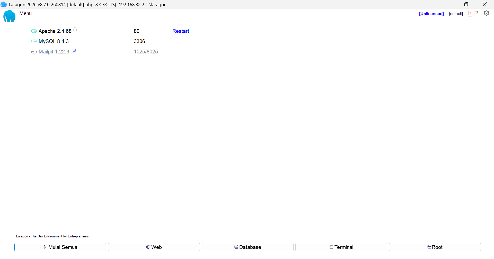

**5.2 Mengakses phpMyAdmin**

phpMyAdmin digunakan untuk mengelola dan memeriksa database yang digunakan oleh aplikasi Barengin.

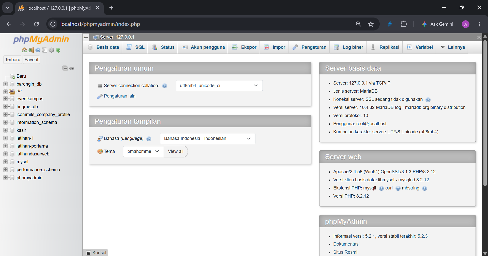

**5.3 Struktur Database**

Menampilkan database `barengin_db` yang digunakan dalam implementasi CRUD API.

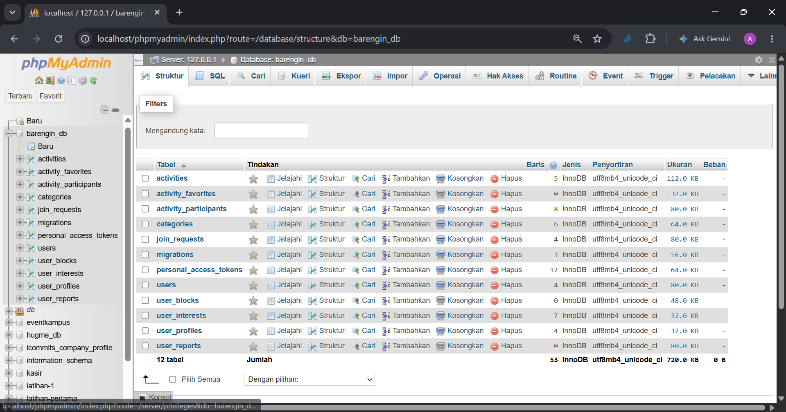

**5.4 Identifikasi Tabel Activities**

Memeriksa tabel `activities` sebagai tabel utama yang menjadi target operasi CRUD.

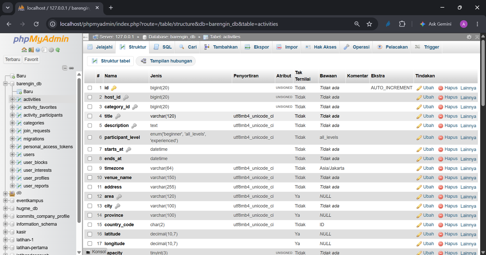

**5.5 Detail Struktur Kolom**

Menampilkan struktur kolom, tipe data, atribut, dan informasi lainnya pada tabel `activities`.

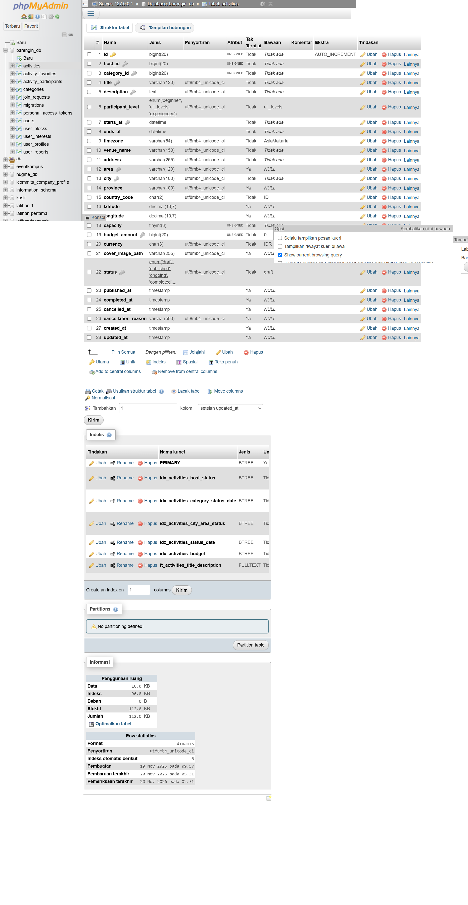

## 6. Implementasi CRUD API

Implementasi API dibagi menjadi empat file utama.

| File | Fungsi |
|---|---|
| `connection.php` | Menghubungkan PHP dengan database menggunakan PDO |
| `get_data.php` | Mengambil data aktivitas |
| `insup_data.php` | Menambahkan dan memperbarui data aktivitas |
| `delete_data.php` | Menghapus data aktivitas |

### 6.1 Connection — Koneksi Database

File: `connection.php`

Digunakan untuk membuat koneksi antara PHP dengan database MySQL menggunakan PDO.

Konfigurasi database lokal:

- Host: `127.0.0.1`
- Database: `barengin_db`
- Username: `root`
- Password: kosong

### 6.2 Read — GET

File: `get_data.php`

Digunakan untuk membaca data aktivitas yang tersimpan dalam tabel `activities`.

**Mengambil seluruh aktivitas:**

```http
GET http://localhost:8080/crud/get_data.php
```

**Mengambil detail aktivitas berdasarkan ID:**

```http
GET http://localhost:8080/crud/get_data.php?id=1
```

### 6.3 Create — POST

File: `insup_data.php`

Digunakan untuk menambahkan data aktivitas baru ke dalam database.

```http
POST http://localhost:8080/crud/insup_data.php
```

Data dikirim melalui Body menggunakan format JSON.

### 6.4 Update — PATCH

File: `insup_data.php`

Digunakan untuk memperbarui informasi aktivitas berdasarkan ID yang dikirimkan melalui Body JSON.

```http
PATCH http://localhost:8080/crud/insup_data.php
```

### 6.5 Delete — DELETE

File: `delete_data.php`

Digunakan untuk menghapus data aktivitas berdasarkan ID.

```http
DELETE http://localhost:8080/crud/delete_data.php?id=6
```

## 7. Hasil Pengujian API

Seluruh operasi CRUD diuji menggunakan Postman. Berikut dokumentasi proses dan hasil pengujiannya.

### 7.1 Persiapan File CRUD API

File PHP disiapkan sebagai komponen utama untuk menjalankan operasi CRUD.

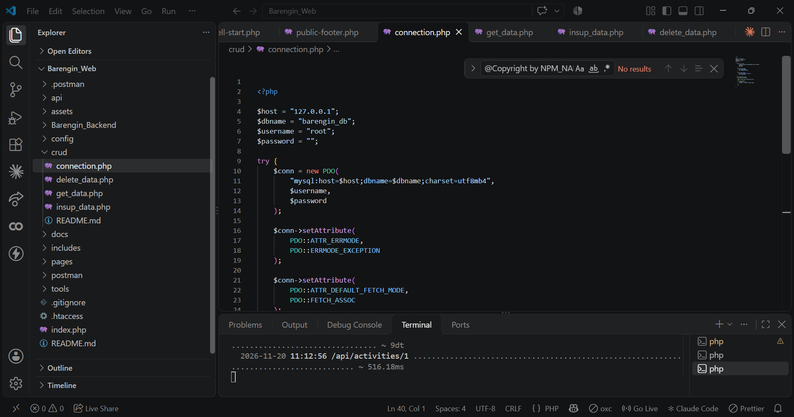

### 7.2 Pengujian Koneksi Database

Pengujian dilakukan untuk memastikan PHP berhasil terhubung dengan database MySQL menggunakan PDO.

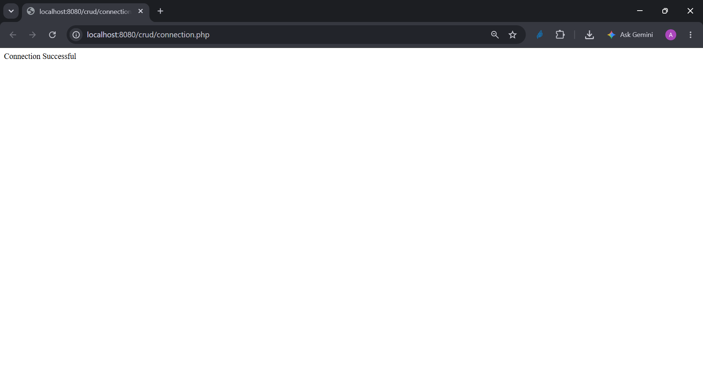

### 7.3 Pengujian Read (GET)

Pengujian GET dilakukan untuk memastikan API dapat mengambil data aktivitas dari database.

**A. GET Seluruh Aktivitas**

Mengambil seluruh data aktivitas yang tersedia dalam tabel `activities`.

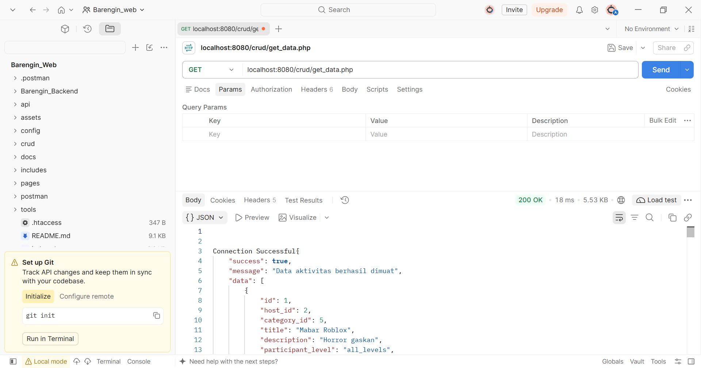

**B. GET Detail Aktivitas**

Mengambil satu data aktivitas berdasarkan ID tertentu.

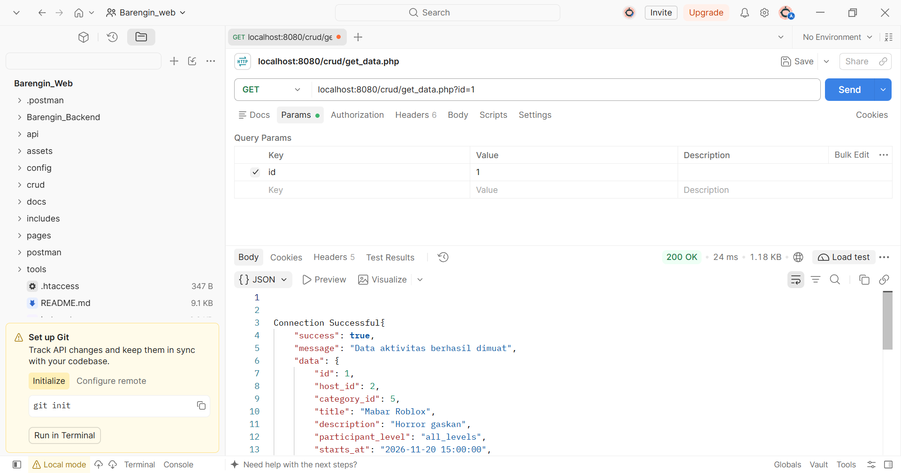

### 7.4 Pengujian Create (POST)

Pengujian POST dilakukan untuk menambahkan aktivitas baru ke dalam database.

**A. Konfigurasi Headers**

Menentukan header yang digunakan dalam pengiriman request API.

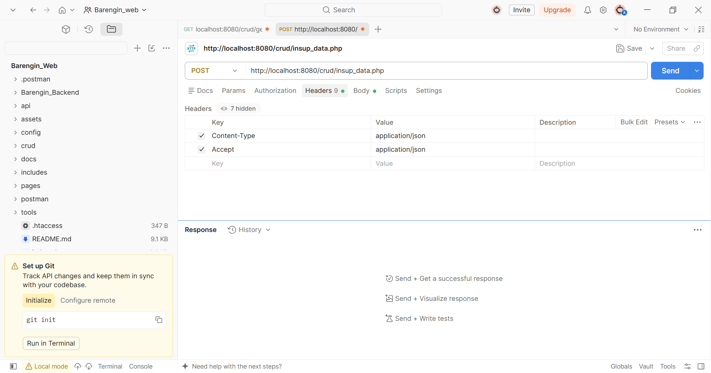

**B. Pengiriman Body JSON**

Mengirimkan data aktivitas baru menggunakan format JSON.

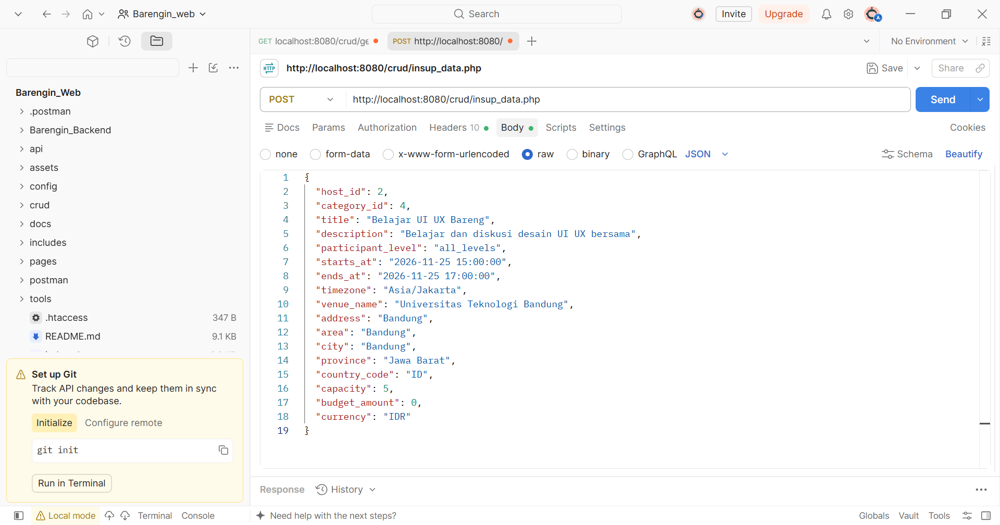

**C. Hasil Pengujian POST**

API berhasil menambahkan aktivitas baru dengan judul *Belajar UI UX Bareng* dan ID `6`.

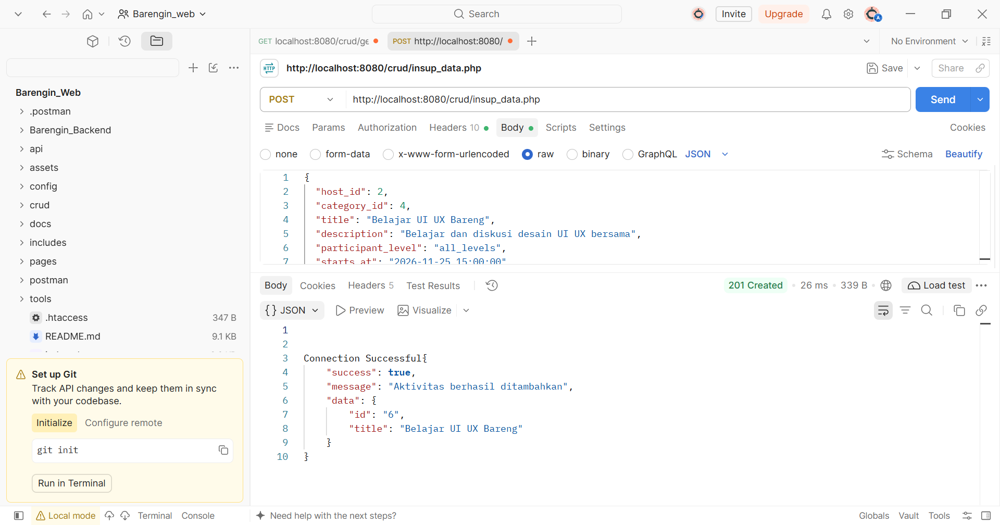

### 7.5 Pengujian Update (PATCH)

Pengujian PATCH dilakukan untuk memperbarui informasi aktivitas yang sudah tersimpan dalam database.

**A. Konfigurasi Headers**

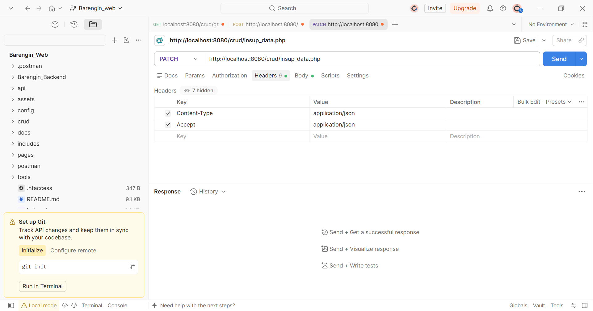

**B. Pengiriman Body JSON**

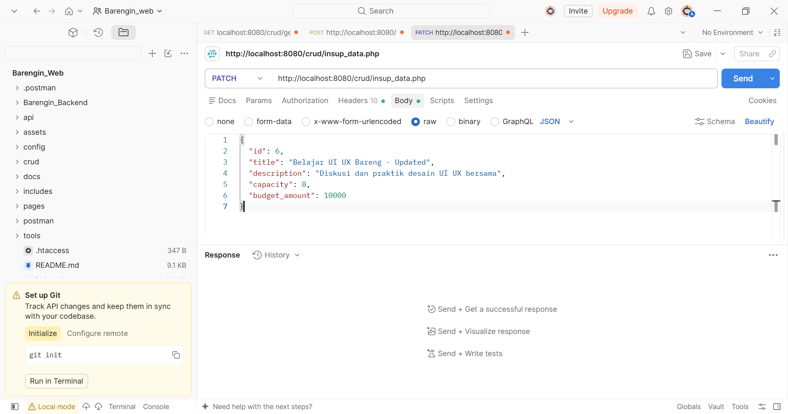

**C. Hasil Pengujian PATCH**

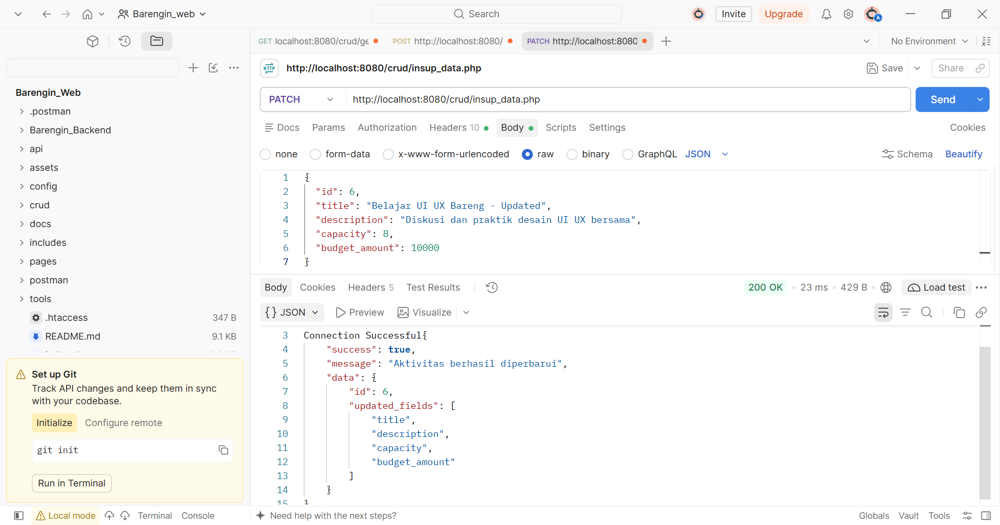

### 7.6 Pengujian Delete (DELETE)

Pengujian DELETE dilakukan untuk menghapus data aktivitas berdasarkan ID.

**A. Konfigurasi Headers**

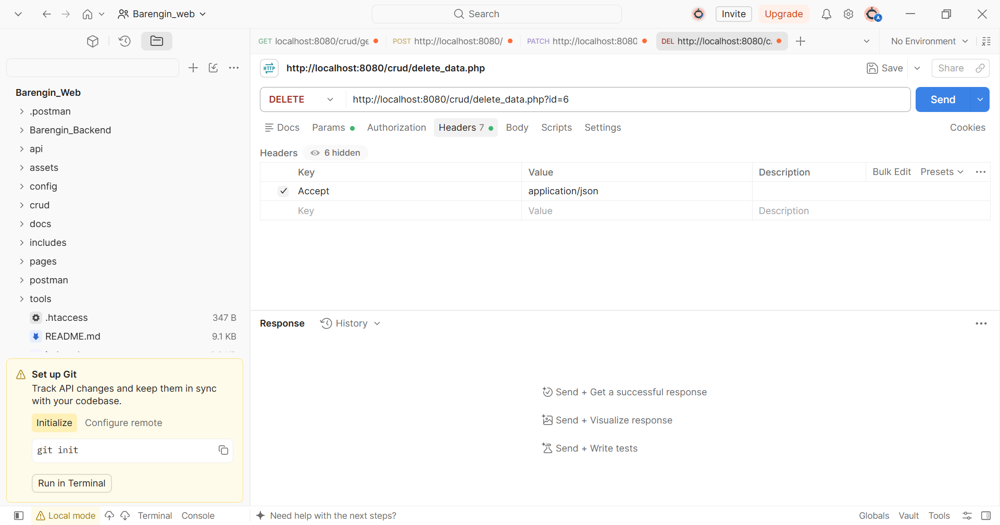

**B. Pengiriman Request DELETE**

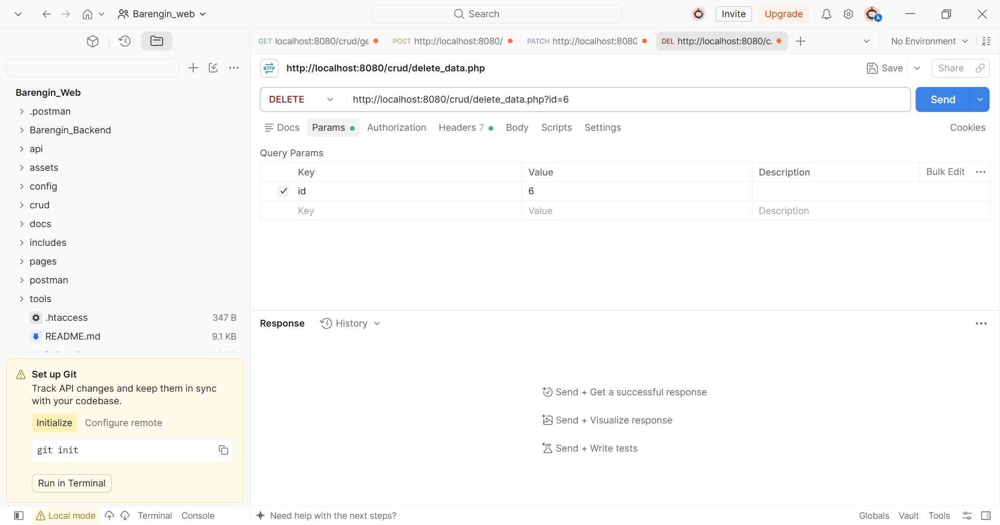

**C. Hasil Pengujian DELETE**

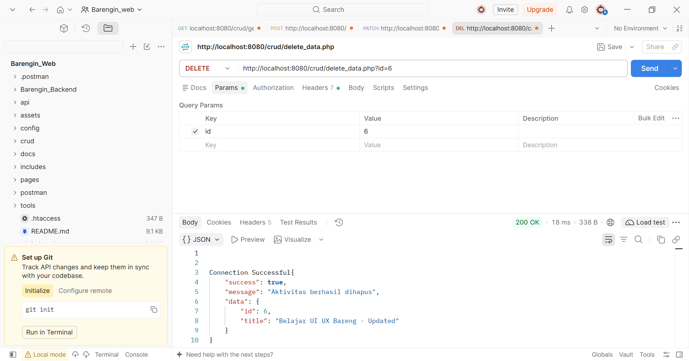

### 7.7 Verifikasi Hasil CRUD

Setelah seluruh operasi CRUD dilakukan, verifikasi dilaksanakan untuk memastikan perubahan data sudah sesuai.

**A. Verifikasi Data yang Dihapus**

Memastikan aktivitas pengujian dengan ID `6` sudah tidak ditemukan dalam database melalui endpoint GET detail.

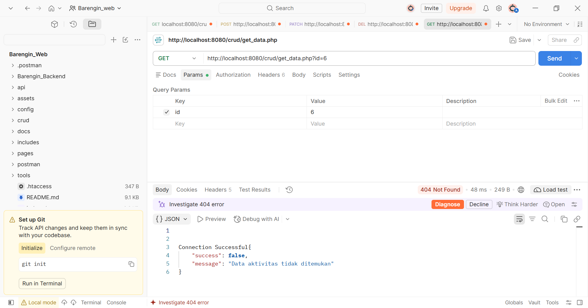

**B. Verifikasi Seluruh Data Aktivitas**

Memastikan data aktivitas lainnya tetap tersedia setelah proses penghapusan dilakukan.

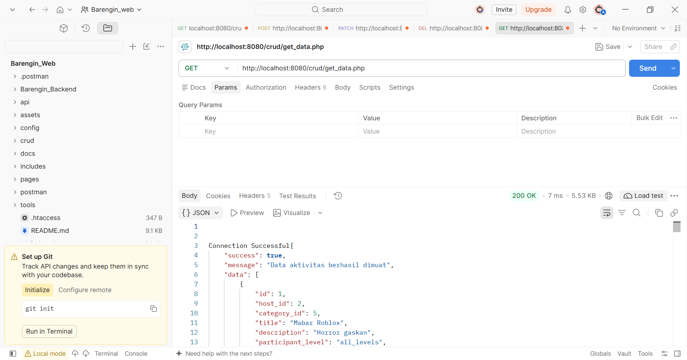

## 8. Cara Menjalankan Project

Berikut langkah-langkah untuk menjalankan CRUD API Barengin pada lingkungan lokal:

1. Pastikan Apache dan MySQL sudah berjalan.
2. Pastikan database `barengin_db` tersedia pada MySQL.
3. Pastikan konfigurasi koneksi pada `connection.php` sudah sesuai dengan pengaturan database lokal.
4. Letakkan folder project pada direktori yang dapat diakses oleh server Apache.
5. Jalankan server lokal.
6. Buka Postman untuk melakukan pengujian API.
7. Gunakan endpoint dan HTTP method sesuai operasi CRUD yang ingin dijalankan.

Contoh alamat endpoint lokal:

```text
http://localhost:8080/crud/get_data.php
```

## 9. Kesimpulan

Berdasarkan hasil implementasi dan pengujian, CRUD API Barengin telah berhasil dibuat menggunakan PHP Native dengan PDO sebagai penghubung ke database MySQL.

Implementasi mencakup empat operasi utama, yaitu Create, Read, Update, dan Delete. Pengujian dilakukan menggunakan Postman untuk memastikan setiap endpoint dapat menjalankan fungsinya sesuai kebutuhan.

Melalui project ini, proses pengelolaan data aktivitas pada aplikasi Barengin dapat dilakukan melalui API yang terhubung langsung dengan database.

---

**PROJECT 2 — PEMROGRAMAN WEB 1**

**BARENGIN | CRUD API IMPLEMENTATION**
